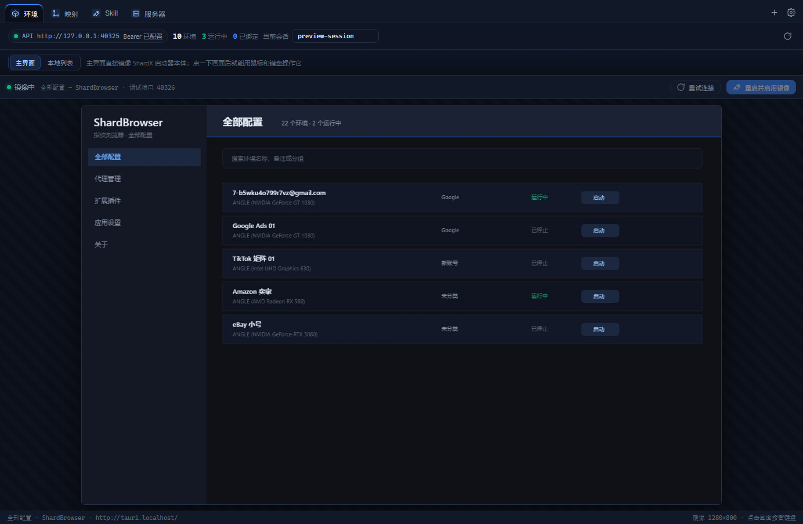
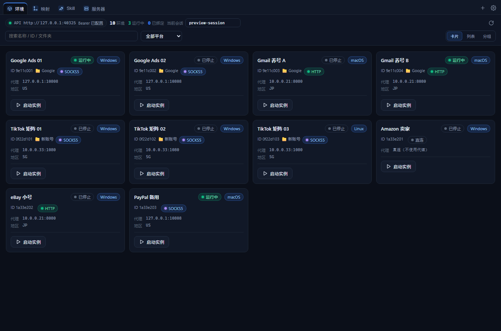
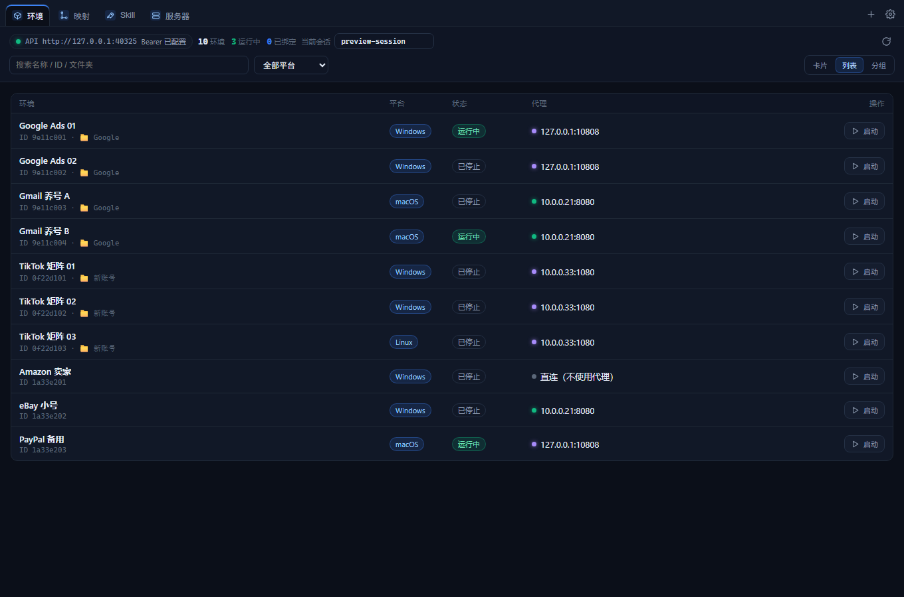
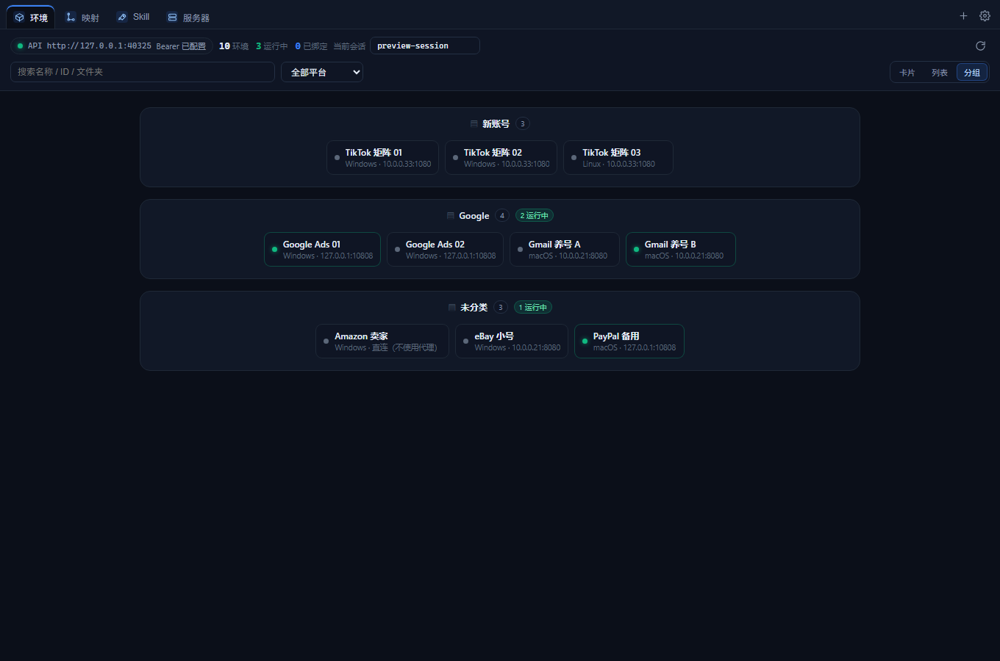
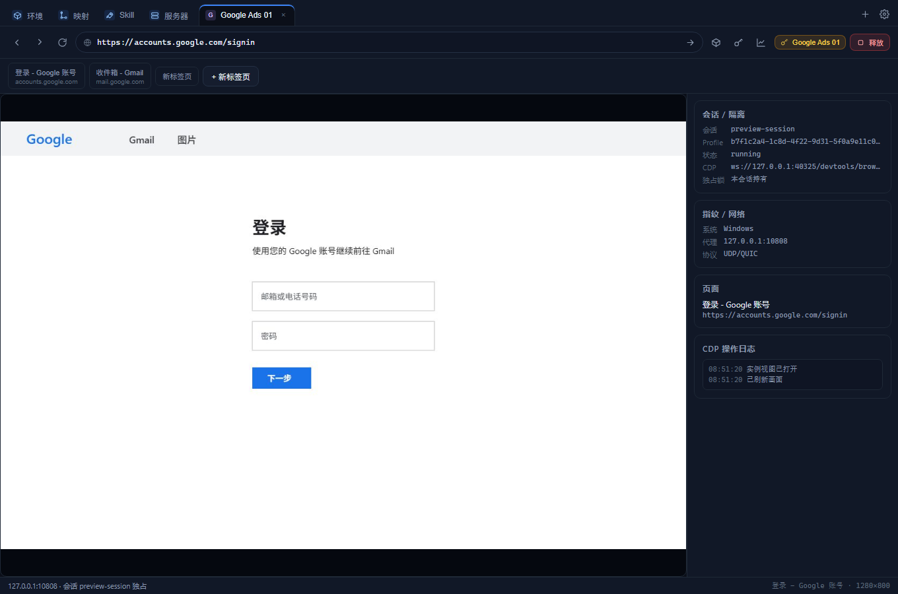
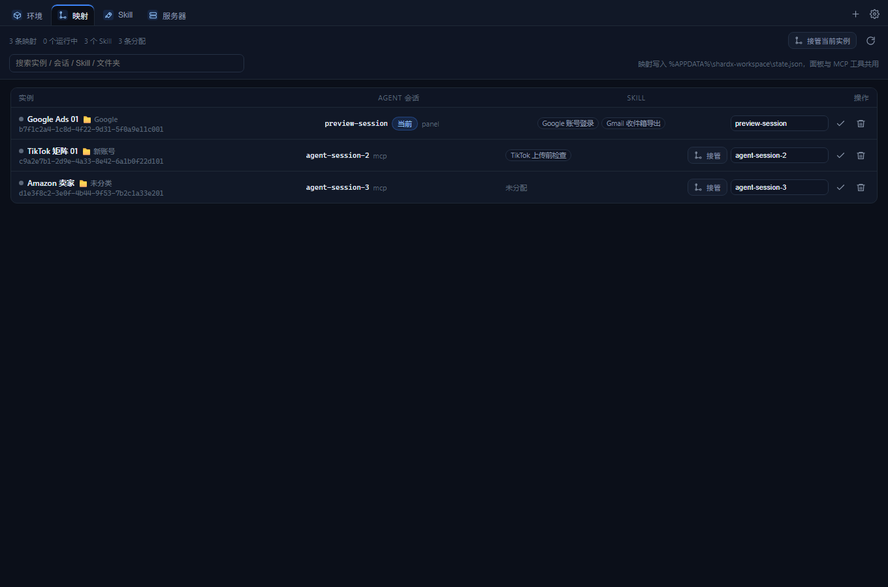
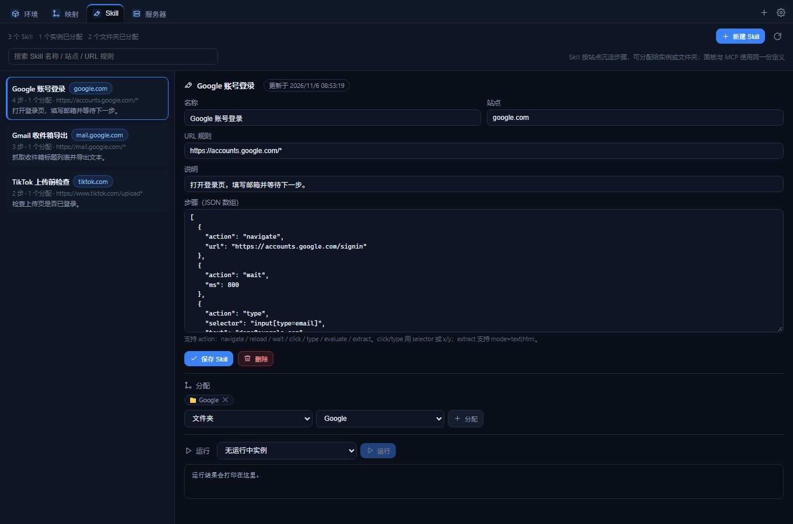
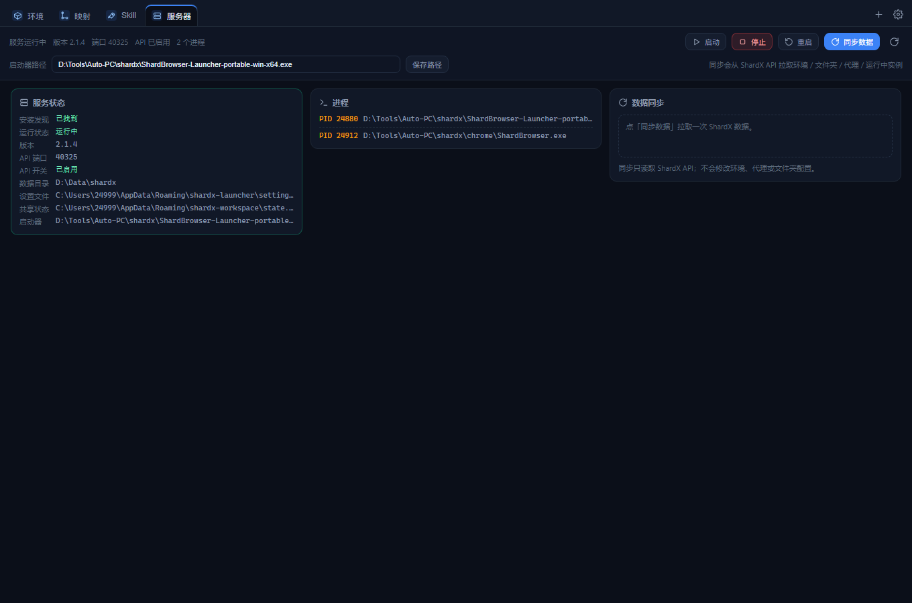
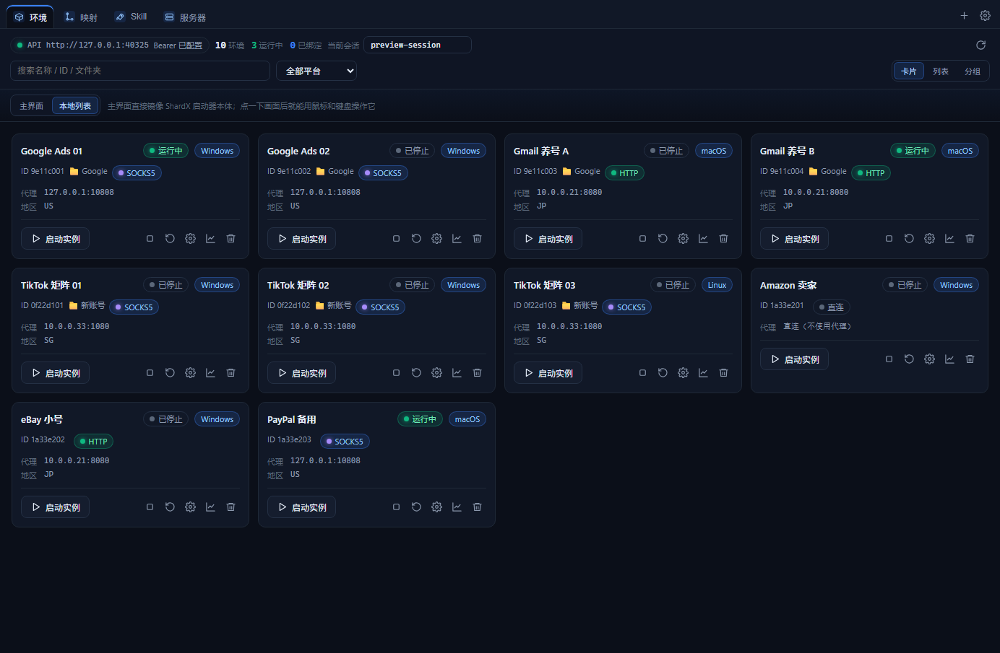
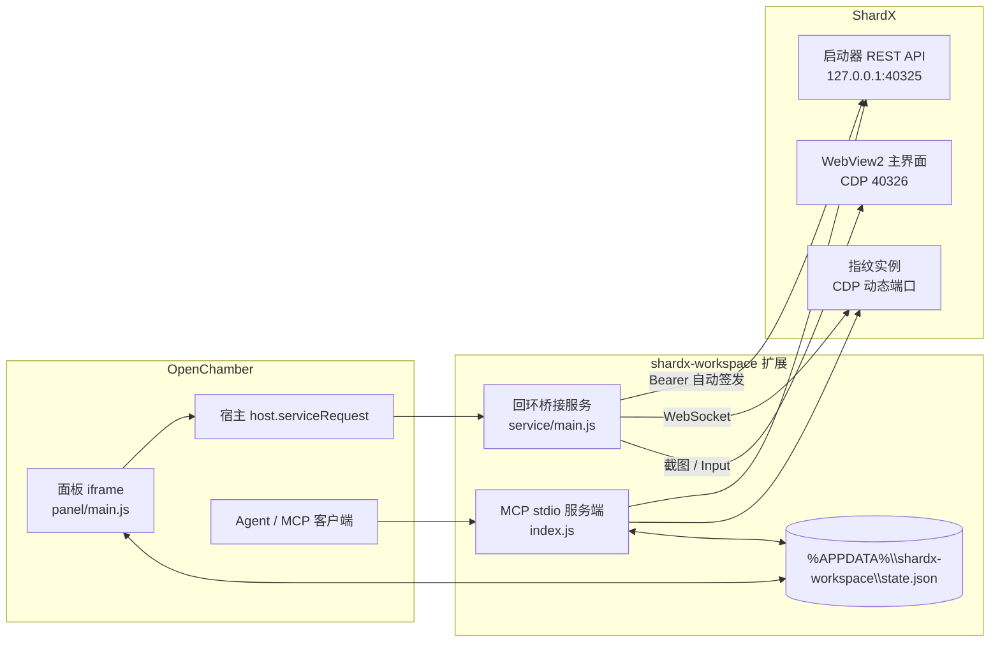

# ShardX Workspace for OpenChamber

> 把 ShardX 指纹浏览器变成 OpenChamber 里的多会话工作台：每个会话独占一个指纹实例，
> 以浏览器标签页的方式并行工作，同时把 32 个 MCP 工具交给 Agent 调度。

[](CHANGELOG.md)
[](docs/MCP-TOOLS.md)
[](#技术约束)
[](https://github.com/wbi35772/openchamber-shardx)



---

## 目录

- [它解决什么问题](#它解决什么问题)
- [功能地图](#功能地图)
- [界面速览](#界面速览)
- [快速开始](#快速开始)
- [MCP 工具](#mcp-工具)
- [架构](#架构)
- [目录结构](#目录结构)
- [开发](#开发)
- [关键设计](#关键设计)
- [路线图](#路线图)
- [文档索引](#文档索引)

---

## 它解决什么问题

ShardX 提供了带独立指纹、代理、Cookie 的浏览器环境，但同一时间只能盯着一个窗口。
OpenChamber 的多个会话又天然需要并行：一个在跑登录流程、一个在抓数据、一个在核对页面。

这个扩展把两者接起来：

- **会话级隔离**：`session_id ↔ profileId` 强绑定，profile 独占锁，两个会话不会抢同一个实例。
- **一个会话多个实例**：同一会话可以同时持有多个 profile，用 `profile_id` 指定操作目标。
- **浏览器式工作台**：固定控制台标签 + 每个实例一条标签，`instance:<profileId>` 作键；关闭标签不停止实例。
- **Agent 可接管**：面板和 MCP 共用同一份 `state.json`，Agent 绑定的实例会直接出现在面板标签栏。
- **零第三方运行时依赖**：面板原生，服务只用 Node 内置模块 + 手写 WebSocket，MCP 也是零依赖。

## 功能地图

| 能力 | 说明 |
|---|---|
| 主界面镜像 | 环境页默认把 ShardX 启动器 WebView2 主界面镜像进面板，截图流 + 鼠标/键盘/滚轮/粘贴/IME 全量转发，随容器尺寸自适应铺满 |
| 本地列表 | 卡片 / 列表 / 标签组三种视图；列表自带文件夹标签（全部环境 + 各分组），表头单击/双击排序、9 种排序字段、升降序 |
| 实例标签 | 地址栏、前进/后退/刷新、实时视口、`Target.getTargets` 子标签、点击/键盘转发、检查器与 CDP 日志 |
| 运行中接管 | 启动器窗口启动的实例自动补读 `DevToolsActivePort` 并后台开标签；旧实例可一键「接管 N 个运行实例」 |
| 会话映射 | 面板内查看/编辑 `session → profile` 映射，与 Agent 的 MCP 调用共享 |
| Skill 自动化 | 按网站沉淀操作步骤（navigate / click / type / wait / evaluate…），分配给实例或文件夹，支持批量执行 |
| 服务器管理 | 启动/停止/重启 ShardX 启动器、探测端口与版本、同步分组/环境/代理/运行实例、自动注入调试参数 |
| 连接自愈 | 每 20s 重新发现启动器；未运行时自动启动（30s 冷却），启动器路径自动解析并落盘 |
| 32 个 MCP 工具 | 环境、页面、分组、代理、指纹、Skill、状态、服务器全链路；真实 E2E 验证 |

## 界面速览

| 卡片视图 | 本地列表 + 文件夹标签 |
|---|---|
|  |  |

| 标签组视图 | 实例视图 |
|---|---|
|  |  |

| 会话映射 | Skill |
|---|---|
|  |  |

| 服务器 | 启动器镜像（本地列表模式） |
|---|---|
|  |  |

## 快速开始

### 前置条件

- OpenChamber **≥ 2.5.0**（扩展 API v1）
- ShardX Launcher **2.1.x**，并在设置中开启自动化 API（默认端口 `40325`）
- Windows（镜像依赖 WebView2；面板与 MCP 的其余能力是跨平台的）
- 构建需要 [Bun](https://bun.sh/)；MCP 服务端需要 **Node ≥ 22**（全局 `WebSocket`）

### 安装扩展

```powershell
# 1. 构建
bun install
bun run typecheck
bun run build

# 2. 复制到 OpenChamber 扩展目录
$dst = "$env:USERPROFILE\.config\openchamber\extensions\shardx-workspace"
New-Item -ItemType Directory -Force $dst | Out-Null
Copy-Item index.js, manifest.json, icon.svg, package.json, panel, service -Destination $dst -Recurse -Force
```

重启 OpenChamber，或重新加载扩展。面板入口为 `panel/index.html`，服务入口为 `service/main.js`。

### 注册 MCP 工具

扩展的 `contributes.tools` 只负责聊天里的展示样式，**不会注册工具**。需要把 `index.js`
注册到 OpenCode 配置（`~/.config/opencode/opencode.json`）：

```json
{
  "mcp": {
    "servers": {
      "shardx-workspace": {
        "type": "local",
        "enabled": true,
        "command": [
          "C:\\Users\\<你>\\.local\\tools\\node\\node.exe",
          "C:\\Users\\<你>\\.config\\openchamber\\extensions\\shardx-workspace\\index.js"
        ]
      }
    }
  }
}
```

注册后工具名形如 `shardx-workspace_list_and_bind_profile`。完整清单见
[docs/MCP-TOOLS.md](docs/MCP-TOOLS.md)。

### 第一次使用

1. 打开 ShardX Workspace 面板 →「环境」。默认进入 **主界面镜像**；若启动器未带调试端口，
   点「重启并启用镜像」（扩展会自动把 WebView2 调试参数写进启动器设置）。
2. 点「本地列表」浏览指纹环境；或直接在镜像主界面里启动实例。
3. 选一个空闲实例 →「绑定到当前会话并启动」。实例会在标签栏出现。
4. 在实例标签里导航、点击、看视口；Agent 侧用同样的 `session_id` 调 MCP 工具即可接力。
5. 切换窗口大小时镜像会按内容区像素重排（`Emulation.setDeviceMetricsOverride`，1:1 填充）。

## MCP 工具

32 个工具，按域分组（详见 [docs/MCP-TOOLS.md](docs/MCP-TOOLS.md)）：

| 域 | 数量 | 代表工具 |
|---|---|---|
| 环境与实例 | 4 | `list_and_bind_profile`、`session_attach`、`session_status`、`session_stop_and_release` |
| 页面自动化 | 8 | `session_navigate`、`session_interact`、`session_snapshot`、`session_wait`、`session_tabs`、`session_screenshot` |
| 分组与环境档案 | 7 | `folder_list`、`folder_rename`、`profile_create`、`profile_edit`、`profile_delete` |
| 代理与指纹 | 5 | `proxy_list`、`proxy_add`、`fingerprint_new`、`fingerprint_list` |
| Skill 自动化 | 4 | `skill_save`、`skill_assign`、`skill_run`、`skill_list` |
| 工作区状态 | 1 | `workspace_state` |
| 服务器控制 | 3 | `server_status`、`server_control`、`server_sync` |

最小调用示例：

```text
shardx-workspace_list_and_bind_profile  { session_id: "demo", action: "auto-bind" }
shardx-workspace_session_navigate       { session_id: "demo", url: "https://example.com" }
shardx-workspace_session_snapshot       { session_id: "demo" }
shardx-workspace_session_stop_and_release { session_id: "demo" }
```

## 架构



三层责任：

- **面板**：只通过宿主的 `host.serviceRequest` 访问回环服务（guest CSP 禁止直连 `127.0.0.1`），
  负责标签、视图、镜像渲染与输入转发。
- **桥接服务**：宿主分配端口与 Bearer；自动发现 ShardX `settings.json`、现场签 HS256 JWT；
  代理 REST、维持 CDP WebSocket、长轮询事件队列、读写共享状态、启动/停止启动器。
- **MCP 服务端**：独立的 stdio 进程，直接驱动 ShardX REST + CDP，与面板共享同一份 state。

## 目录结构

```text
openchamber-shardx/
├── package.json            # OpenChamber 运行时清单（contributes.panel/service/tools）
├── manifest.json           # MCP 工具目录（32 个 name/description/inputSchema）
├── index.js                # MCP stdio 服务端（零依赖，Node ≥ 22）
├── icon.svg
├── panel/
│   ├── index.html          # 面板入口
│   ├── main.ts             # 宿主握手、transport 初始化、自动探测
│   ├── transport.ts        # host.serviceRequest 封装
│   ├── api.ts              # ShardX REST 客户端 + discover/鉴权
│   ├── cdp.ts              # CDP 多路复用（命令 id / 事件分发 / 重连）
│   ├── router.ts           # 会话 ↔ profile 独占路由
│   ├── bridge.ts           # 面板侧实例控制（启动/接管/释放）
│   ├── mirror.ts           # 启动器 WebView2 镜像（截图 + Input + Emulation）
│   ├── ui.ts               # 标签工作台、四页 UI、排序/分组/接管
│   ├── workspace.ts        # 共享状态客户端
│   └── types.ts / util.ts / style.css
├── service/
│   ├── main.ts             # 回环 HTTP 桥接（19 条路由）
│   └── ws.ts               # 手写 RFC6455 客户端（零依赖）
├── preview/                # 离屏预览 harness + 截图
├── docs/
│   ├── ARCHITECTURE.md     # 架构、数据流、不变量
│   ├── MCP-TOOLS.md        # 自动生成的工具参考
│   ├── OPERATIONS.md       # 构建、部署、排障
│   ├── ROADMAP.md          # 迭代路线
│   └── canvas/             # Canvas 项目图鉴（可视化文档）
└── scripts/gen-docs.mjs    # 从 manifest 生成文档与 Canvas 数据
```

## 开发

```powershell
bun install
bun run typecheck        # tsc --noEmit
bun run build            # panel/main.js + service/main.js
bun run validate         # 校验 manifest.json
bun run docs:gen         # manifest → docs/MCP-TOOLS.md + docs/canvas/tool-data.js
```

预览面板（不启动 OpenChamber，使用假宿主与假 ShardX 数据）：

```powershell
bunx openchamber-guest-bundle preview/preview.ts preview/preview.js
# 然后打开 preview/index.html?mode=cards|list|groups、?tab=mapping|skills|server、?view=instance
```

## 关键设计

<details>
<summary><b>为什么需要本地桥接服务？</b></summary>

面板 iframe 的 CSP 只允许访问 guest 文件源，清单里的 `origins` 只接受 https，
`http://127.0.0.1:40325` 无法声明成可直连来源。因此面板把 `{method, path, body}` 交给
`host.serviceRequest`，由宿主启动的 service 进程访问网络。每条路由（含 `/health`）
都校验宿主注入的 `Authorization: Bearer <token>`。
</details>

<details>
<summary><b>不用手填端口和 Token</b></summary>

`service/main.ts` 的 `/shardx/discover` 读取 `%APPDATA%\shardx-launcher\settings.json`，
取 `api_port` / `api_secret`，用 `api_secret` 现场签 HS256 JWT（`sub=shardx-api`）作为 Bearer。
手动填写的 Token 优先，不会被自动检测覆盖。
</details>

<details>
<summary><b>镜像为什么要重启启动器？</b></summary>

启动器是 Tauri + WebView2，命令行调试参数无效，必须在启动时注入环境变量
`WEBVIEW2_ADDITIONAL_BROWSER_ARGUMENTS='--remote-debugging-port=40326 --remote-allow-origins=*'`。
扩展启动 ShardX 时自动合并；已在运行的启动器可点「重启并启用镜像」。
</details>

<details>
<summary><b>UI 启动的实例为什么一开始没有 CDP 端口？</b></summary>

启动器窗口启动的实例不会把端口告诉 API。服务端在启动器 `settings.json` 的 `extra_args`
注入 `--remote-debugging-port=0 --remote-allow-origins=*`，浏览器把实际端口写入
`user-data/<profileId>/DevToolsActivePort`；`POST /instances/running` 为缺少 `cdp` 的运行实例
补读该文件，面板因此能自动开标签。仍无端口的旧实例可一键接管（停止并用 API 重启）。
</details>

## 技术约束

- 零第三方运行时依赖：服务只用 Node 内置模块 + 手写 RFC6455，不引入 `ws`；MCP 同理。
- 面板不直接访问网络，全部经宿主回环桥接。
- 实例 profile 独占：同一 profile 同时只能被一个会话锁定。
- 构建产物 `panel/main.js`、`service/main.js` 与源码一起提交，便于直接部署。
- 不用 `// TODO` 或占位实现；未验证的能力不写进工具目录。

## 路线图

- [x] 四页控制台 + 浏览器式实例标签
- [x] CDP 多路复用、截图视口、点击/键盘转发
- [x] 分组标签组视图、拖拽排序、多字段排序
- [x] 启动器主界面镜像 + 自适应铺满 + 输入转发
- [x] 运行中实例自动接管、连接自愈
- [x] 32 个 MCP 工具与真实 E2E
- [x] 项目图鉴（Canvas）+ 自动生成文档
- [ ] 跨会话独占冲突的可视化提示
- [ ] Skill 录制器（从一次真实操作生成步骤）
- [ ] 多启动器/远程 ShardX 节点
- [ ] 面板内 Cookie 编辑器与网络日志

详见 [docs/ROADMAP.md](docs/ROADMAP.md)。

## 文档索引

| 文档 | 内容 |
|---|---|
| [docs/ARCHITECTURE.md](docs/ARCHITECTURE.md) | 模块职责、调用链、状态模型、不变量 |
| [docs/MCP-TOOLS.md](docs/MCP-TOOLS.md) | 32 个工具的完整参数参考（自动生成） |
| [docs/OPERATIONS.md](docs/OPERATIONS.md) | 构建、部署、环境变量、故障排查 |
| [docs/ROADMAP.md](docs/ROADMAP.md) | 版本历史与后续迭代 |
| [HANDOFF.md](HANDOFF.md) | 逐轮开发记录与真实验证证据 |
| [docs/canvas/](docs/canvas/) | 可视化项目图鉴源码与截图 |

图鉴是单文件页面，直接用浏览器打开 [`docs/canvas/index.html`](docs/canvas/index.html) 即可；托管版发布在 Canvas 工件里（更新流程见 `docs/OPERATIONS.md` 第 9 节）。

## License

MIT
