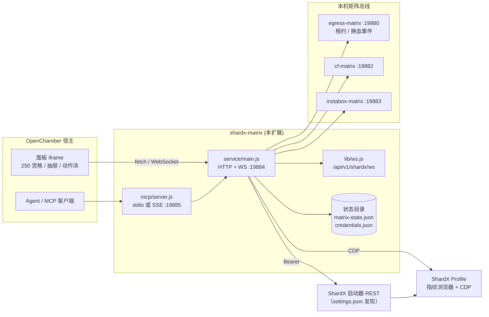

# ShardX Matrix · OpenChamber 扩展 v2

把 250 个指纹浏览器槽位收进一张固定矩阵：槽位 `slot-001..slot-250` 永远对应出口端口
`24001-24250`，启动时向 egress 总线取租约、把 ShardX Profile 的代理 / 时区 / 语言对齐到
出口国家，再用 CDP 接管已经跑起来的浏览器。面板负责编排，Agent 通过 5 个 MCP 工具做同样的
事。

- 扩展 ID：`shardx-matrix`（面板、服务、总线、工具统一使用这个 ID）
- 宿主要求：OpenChamber ≥ 2.5.0，guest 扩展（`package.json` 的 `openchamber.apiVersion: 1`）
- 运行时：Node ≥ 20，零运行时依赖；`playwright-core` 可选，仅用于非 ShardX 浏览器的调试
- 平台：Windows（ShardX 启动器）+ WSL2 宿主（自动发现 Windows 侧 `%APPDATA%`）

## 1. 它能做什么

| 能力 | 说明 |
|---|---|
| 250 个固定槽位 | `slot-NNN` ↔ `127.0.0.1:240NN` 一一对应，端口数学集中在 `core/contract.js` |
| egress 租约对齐 | 启动前向 `127.0.0.1:19880` 取租约，失败即拒绝启动（`requireEgressLease`） |
| 出口身份对齐 | 自动创建 / 复用槽位代理，按出口国家写时区、locale、`webrtc=proxy` |
| CDP 接管 | 已运行的 Profile 直接接管；未运行才启动，统一走 `waitForCdp` |
| 换血冻结屏障 | 收到 `PRE_ROTATION_FREEZE` 立即 `ACK_FREEZE`，动作等待 `POST_ROTATION_RESUME` |
| 人类化动作 | 动作间泊松延迟 400–1800ms，任务逐步记录日志 |
| 语义观测 | 返回 URL、标题、可见文本、ARIA 树和稳定的 `e1..eN` 元素引用 |
| 加密凭据 | Cookie 等凭据用 AES-256-GCM 落盘，密钥在状态目录 `secret.key` |
| 面板 + 5 MCP 工具 | 面板 250 宫格、筛选、抽屉动作流；Agent 用同一套 REST 能力 |
| 单实例编排 | 服务端唯一编排器，面板 / MCP 都只是 `127.0.0.1:19884` 的客户端 |

## 2. 架构



端口与路径的单一事实源是 `core/contract.js`：

| 常量 | 值 |
|---|---|
| `SHARDX_SERVICE_PORT` | `19884` |
| `SHARDX_MCP_SSE_PORT` | `19885` |
| `SHARDX_WS_PATH` | `/api/v1/shardx/ws` |
| egress / CF / Instabox 总线 | `19880` / `19882` / `19883` |
| 槽位端口 | `24000 + index`，即 `24001–24250` |

## 3. 安装

扩展目录：

```powershell
$dst = "$env:USERPROFILE\.config\openchamber\extensions\shardx-matrix"
New-Item -ItemType Directory -Force $dst | Out-Null
Copy-Item package.json, icon.svg -Destination $dst -Force
Copy-Item core, lib, service, mcp, panel -Destination $dst -Recurse -Force
```

部署后重新加载扩展（或重启 OpenChamber）。宿主启动 `service/main.js` 时会注入
`OPENCHAMBER_SERVICE_TOKEN`；面板由服务自体在 `http://127.0.0.1:19884/` 提供。

> v2 只通过 `package.json` 的 `openchamber` 字段被发现，没有 `manifest.json`。v1
> （`shardx-workspace`）的 `index.js`、`panel/*.ts`、`preview/`、`docs/canvas/` 已从仓库
> 移除；已安装的旧扩展目录可以继续保留，两者互不共享状态。

### MCP 注册

stdio（默认）：

```json
{
  "mcp": {
    "servers": {
      "shardx-matrix": {
        "type": "local",
        "enabled": true,
        "command": [
          "node",
          "C:\\Users\\<you>\\.config\\openchamber\\extensions\\shardx-matrix\\mcp\\server.js"
        ]
      }
    }
  }
}
```

SSE（给不能起子进程的客户端）：

```powershell
node mcp/server.js --sse --port 19885
# MCP 端点：http://127.0.0.1:19885/sse，消息回传：/messages?sessionId=...
```

MCP 进程只转发到 `SHARDX_MATRIX_SERVICE_URL`（默认 `http://127.0.0.1:19884`），
不自己碰浏览器；服务没启动时工具返回 `ERR_EGRESS_UNAVAILABLE` / HTTP 503 类错误。

## 4. 快速开始

1. 打开面板，点一个空槽位 → 绑定 Profile（同一个 Profile 只能绑定一个槽位）。
2. 点「启动」。服务依次：取 egress 租约 → 确保 `127.0.0.1:240NN` 代理 → 对齐
   Profile → 启动或复用实例 → CDP 接管 → 打开 `defaultStartUrl`。
3. 点槽位打开抽屉：截图、观测、快速动作（goto/click/fill/press/scroll/wait/extract/
   assertText/hover/eval）、动作流。
4. 需要批量时点「任务」，填入动作数组 JSON；每一步之间自动加泊松延迟，冻结期间自动等待。
5. Agent 侧直接调 `shardx_slot_launch` / `shardx_page_observe` / `shardx_page_act` /
   `shardx_task_run` / `shardx_slot_close`，详见 [docs/MCP-TOOLS.md](docs/MCP-TOOLS.md)。

## 5. 状态目录

默认 `~/.openchamber-shardx-matrix`（Windows：`C:\Users\<you>\.openchamber-shardx-matrix`），
可用 `SHARDX_MATRIX_STATE_DIR` 覆盖：

| 文件 | 内容 |
|---|---|
| `matrix-state.json` | 槽位绑定、健康状态、任务历史（环形 200）、事件 |
| `credentials.json` | AES-256-GCM 加密的 Cookie / 凭据 |
| `secret.key` | 本机凭据密钥（0600） |
| `screenshots/` | 截图，保留最近 `screenshotRetention` 张（默认 50） |

删除状态目录会丢失绑定、凭据和任务历史；Profile 与代理仍在 ShardX 里。

## 6. 环境变量

| 变量 | 作用 |
|---|---|
| `OPENCHAMBER_SERVICE_TOKEN` | 宿主注入；服务和 MCP 都要求 `Authorization: Bearer <token>` |
| `SHARDX_MATRIX_SERVICE_URL` | MCP 的上游服务地址，默认 `http://127.0.0.1:19884` |
| `SHARDX_MATRIX_STATE_DIR` | 状态目录覆盖 |
| `SHARDX_API_BASE` | 显式指定 ShardX 启动器 REST 地址 |
| `SHARDX_LAUNCHER_SETTINGS` | 显式指定启动器 `settings.json` |
| `SHARDX_MCP_LOG=1` | MCP 错误输出到 stderr |

## 7. 目录结构

```
core/      contract / store-lock / host-bridge / profile-store
lib/       ws / http-client / egress-client / shardx-client / cdp-runner / slot-manager / scheduler
service/   唯一编排器：HTTP 路由、WS 总线、静态面板
mcp/       JSON-RPC stdio + SSE 传输，5 个工具
panel/     250 宫格、抽屉、动作流、设置
tests/     node:test 端到端（mock egress / ShardX / CDP）
```

## 8. 开发与校验

```powershell
npm run check   # node --check 全部源码
npm test        # 8 个 node:test 用例，约 0.5s
```

测试自带 mock egress、mock ShardX 启动器和 mock CDP 页面，不触碰真实浏览器。当前基线：
8/8 通过，进程正常退出。

## 9. 更多文档

| 文档 | 内容 |
|---|---|
| [docs/ARCHITECTURE.md](docs/ARCHITECTURE.md) | 模块边界、启动 / 冻结时序、不变量 |
| [docs/MCP-TOOLS.md](docs/MCP-TOOLS.md) | 5 个 MCP 工具的参数、返回与示例 |
| [docs/OPERATIONS.md](docs/OPERATIONS.md) | 部署、MCP 注册、排障、日志 |
| [docs/ROADMAP.md](docs/ROADMAP.md) | v2 状态与后续方向 |
