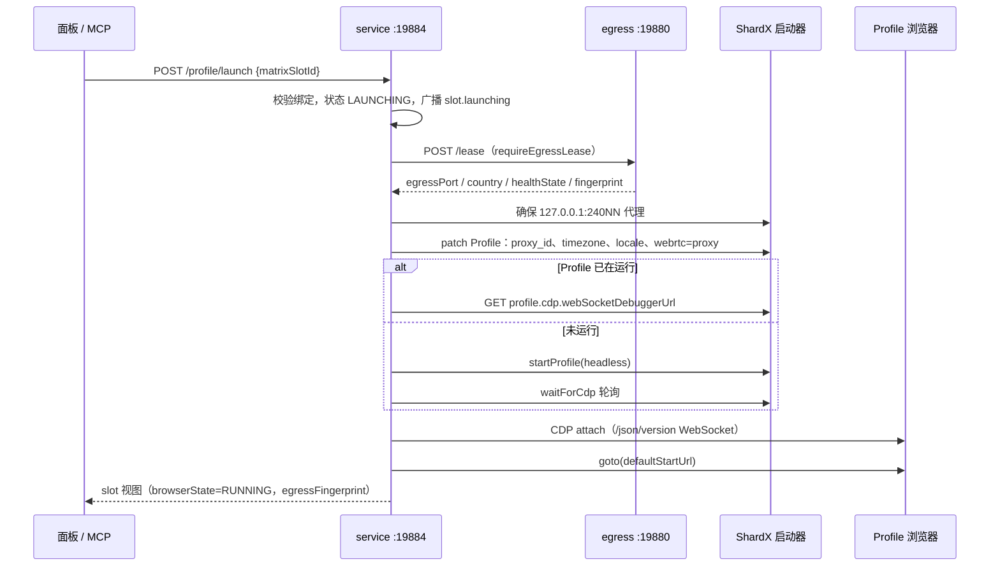

# 架构（v2）

本文记录模块边界、时序、状态模型和不变量。改代码前先看「不变量」：破坏它们通常不会立刻
报错，但会在多会话 / 多槽位场景下串线。

## 1. 模块

```
core/contract.js        槽位、端口、状态机、路由平面、端口数学的唯一事实源
core/store-lock.js      跨进程文件锁 + 原子写（state / credentials）
core/host-bridge.js     ShardX 启动器发现：%APPDATA%\shardx-launcher\settings.json、
                        WSL2 网关、SHARDX_API_BASE / SHARDX_LAUNCHER_SETTINGS
core/profile-store.js   状态文件、设置归一化、绑定、任务环形记录、AES-256-GCM 凭据

lib/ws.js               RFC6455 双端实现：服务端 hub + 客户端连接、心跳、ACK 等待
lib/http-client.js      超时 / 非 2xx / JSON 解析统一入口
lib/egress-client.js    19880 租约、槽位缓存、WS 换血事件、冻结等待
lib/shardx-client.js    启动器 REST（Bearer）、Profile / 代理、时区 / locale 对齐、CDP 发现
lib/cdp-runner.js       CDP 连接、语义快照（e1..eN）、动作执行、泊松延迟
lib/slot-manager.js     编排器：启动 / 关闭 / 任务 / 冻结 / 代理同步 / 事件广播
lib/scheduler.js        重试、退避、任务队列辅助

service/main.js         唯一进程入口：HTTP 路由 + WS hub + 静态面板 + 授权
mcp/server.js           MCP stdio / SSE，薄客户端，5 个工具
panel/                  250 宫格、抽屉、动作流、设置；同源 fetch + WS
tests/                  node:test，对 mock egress / ShardX / CDP 做端到端断言
```

扩展入口只来自 `package.json` 的 `openchamber` 字段（v2 没有 `manifest.json`）。
v1（`shardx-workspace`）的 `index.js`、`panel/*.ts`、`preview/`、`docs/canvas/` 已移除。

## 2. 端口与路径

| 用途 | 地址 |
|---|---|
| 本扩展服务 / 面板 / 总线 WS | `http://127.0.0.1:19884`，WS `/api/v1/shardx/ws` |
| MCP SSE（可选） | `http://127.0.0.1:19885/sse` |
| egress-matrix | `http://127.0.0.1:19880`，WS `/api/v1/egress/ws`，租约 `POST /api/v1/egress/lease` |
| cf-matrix / instabox-matrix | `19882` / `19883`（`/api/v1/cf/bus-health`、`/api/v1/instabox/bus-health`） |
| 槽位出口 | `127.0.0.1:24001–24250` |
| ShardX 启动器 | `settings.json` 的 `api_port` + `api_secret` |

健康检查：`GET /health`（本服务）、`GET /api/v1/shardx/bus-health`（槽位 / 任务 /
WS 客户端 / egress 状态）、`GET /api/v1/shardx/integrations`（四条总线探测，3s 缓存）。

## 3. 启动时序



任何一步失败：状态置 `ERROR`、写入 `lastError`、广播 `slot.failed` + `slot.updated`，
异常原样返回给调用方。同一槽位并发启动共享同一个 Promise（`launching` map）。

## 4. 换血冻结

egress 总线在换出口前广播 `PRE_ROTATION_FREEZE`：

1. `lib/egress-client.js` 把槽位标脏，并立即回 `ACK_FREEZE { eventId }`。
2. 所有动作入口（`page_act`、`task_run`、启动后的 `goto`）先
   `waitForUnfrozen(slot, freezeTimeoutMs)`；超时抛 `egress_rotation_timeout`。
3. `POST_ROTATION_RESUME` / `ROTATION_RESUME` 解除等待；`ROTATION_FAILED` 记录日志并解除。
4. 面板通过 hub 收到 `rotation.freeze` / `rotation.resume` / `rotation.failed`，
   抽屉显示「换血中」。

服务端 hub 的 `broadcastAwait()` 负责把冻结事件发给面板并等待面板 ACK：
客户端 ID 去重、超时统一收口、`eventId` 保留上游值（没有才生成）。

## 5. 任务执行

`POST /task/execute` → `manager.runTask`：

1. 校验绑定，确保 CDP 会话（必要时先启动）。
2. 生成 `taskId`，写 store（环形 200 条），广播 `task.started`。
3. 逐步执行 `runStep`，每步前等冻结解除，步间泊松延迟；`retries` 1–5 次。
4. 每步广播 `task.log`，完成后广播 `task.done`，同步 `slot.updated`。
5. `POST /task/cancel` 或槽位休眠 → `CANCELLED`；错误 → `FAILED`，保留 `lastError`。

`runStep` 成功返回必带 `ok: true`；调用方据此判定，不看 HTTP 层。

## 6. 状态模型

`matrix-state.json`（版本 2）：

| 字段 | 说明 |
|---|---|
| `bindings[]` | `matrixSlotId`、`profileId`、`profileName`、`browserState`、`healthState`、`egressFingerprint`、`lastUrl`、`lastTitle`、`lastError`、时间戳 |
| `tasks[]` | 最近 200 条任务，含步骤结果与日志（每任务日志环形 300） |
| `events[]` | 面板事件流（最近 100 条） |
| `settings` | 见下 |
| `counters` | `launches` / `sleeps` 等累计值 |

设置默认值：`servicePort=19884`、`defaultStartUrl=about:blank`、`headless=false`、
`poissonMinMs=400`、`poissonMaxMs=1800`、`freezeTimeoutMs=30000`、`launchTimeoutMs=60000`、
`requireEgressLease=true`、`screenshotRetention=50`，以及三条总线 URL。

浏览器状态机：`STOPPED → LAUNCHING → RUNNING → CLOSING → STOPPED`，失败分支 `ERROR`。
任务状态机：`QUEUED → RUNNING → DONE / FAILED / CANCELLED`。

`credentials.json` 只存密文；`secret.key` 首次使用时生成（0600）。凭据接口永远不会回显明文，
导入后返回 cookie 名列表。

## 7. WS 协议

`/api/v1/shardx/ws?clientId=...&role=panel|observer`。

- 服务端帧：`slot.updated`、`slot.bound`、`slot.unbound`、`slot.launching`、`slot.launched`、
  `slot.closed`、`slot.failed`、`task.started`、`task.log`、`task.done`、`rotation.freeze`、
  `rotation.resume`、`rotation.failed`、`settings.updated`、`SERVICE_READY`。
- 客户端帧：`ACK_FREEZE { eventId }`（面板）、`ping` / `pong`、`close`。
- 服务端发出的帧不掩码（浏览器 WebSocket 要求）；客户端帧必须掩码。
- 心跳 30s；连接关闭码 `1001` 表示服务退出。

## 8. 不变量

1. 端口数学只在 `core/contract.js`：`slot-001 ↔ 24001`，`slot-250 ↔ 24250`；
   任何模块不得自算端口。
2. 一个 Profile 同时只能绑定一个槽位；绑定写入必须在 `withStateLock` 内完成。
3. 启动前必须先拿到租约（默认强制）；拿不到就失败，不降级直连。
4. 动作只能在 CDP 会话存在时执行；`ensureSession` 是唯一入口。
5. 冻结期间不允许任何页面动作；`waitForUnfrozen` 不得被绕过。
6. 凭据明文只存在于内存；落盘必须加密，日志不得出现 Cookie 值。
7. 面板 / MCP 不直接访问 ShardX 或浏览器，只走 `127.0.0.1:19884`。
8. 服务端帧不掩码、客户端帧掩码；`WsConn` 的 `mask` 选项不得在两端混用。
9. `runStep` 成功必须返回 `ok: true`，失败必须抛错或返回 `ok: false`，不得返回空对象。
10. 状态文件必须原子写（临时文件 + rename），锁超时 20s、陈旧 60s。
