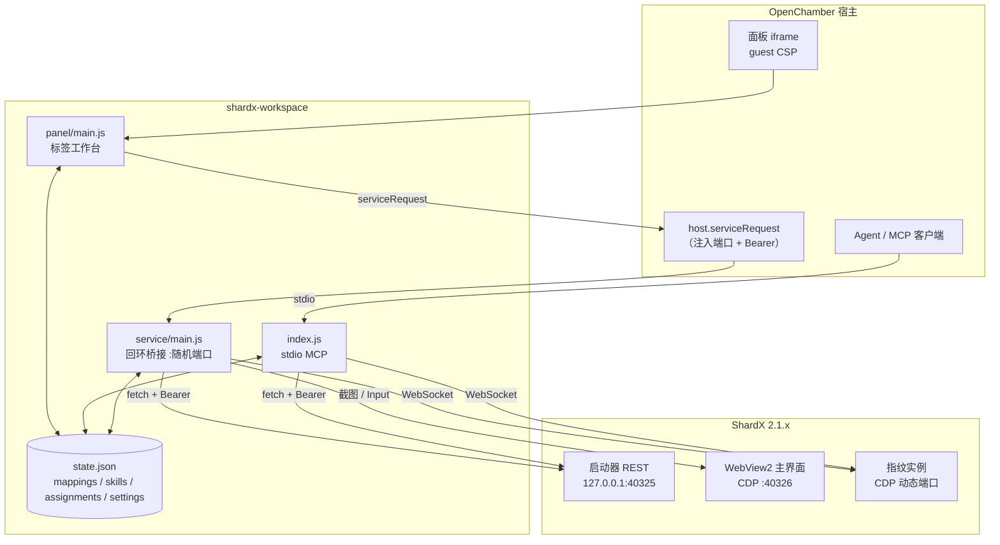
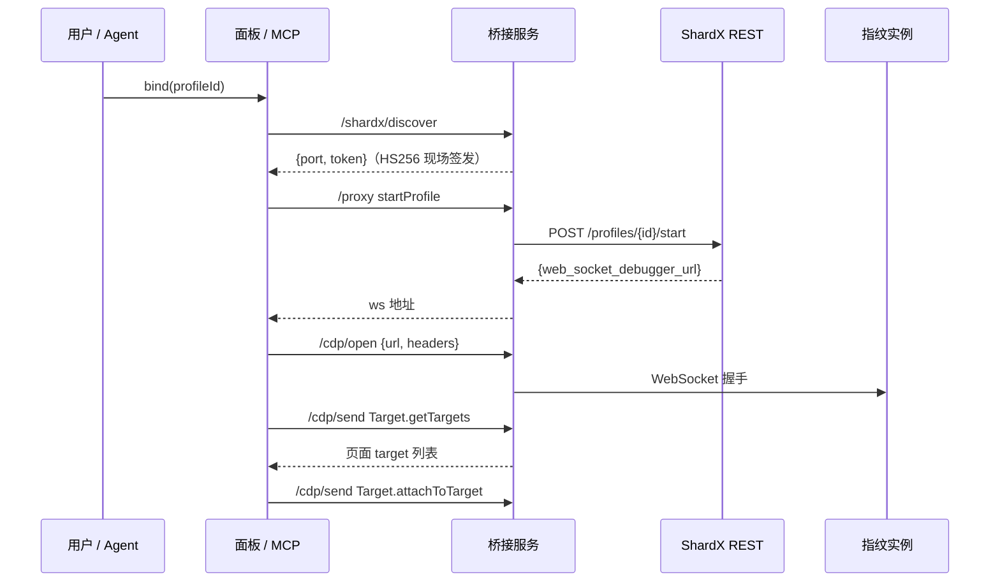
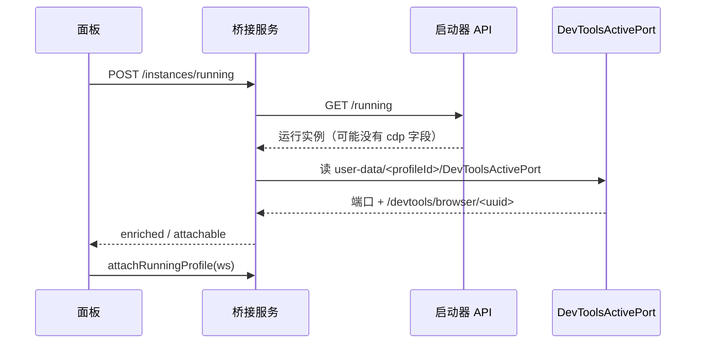
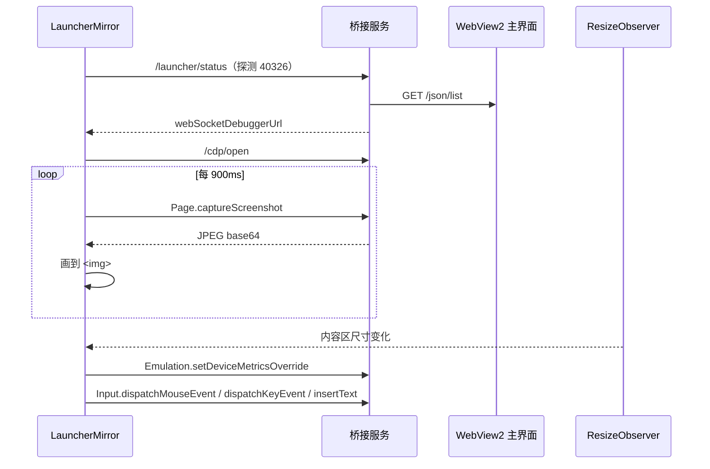

# 架构

本文记录模块边界、调用链、状态模型和必须保持的不变量。改代码前先看这里，
尤其是「不变量」一节——破坏它们通常不会立刻报错，但会在多会话场景下串线。

## 1. 总览



三层职责：

| 层 | 进程 | 能做什么 | 不能做什么 |
|---|---|---|---|
| 面板 | 宿主内 iframe | 渲染 UI、标签路由、镜像画布与输入映射 | 直接访问 `127.0.0.1`（CSP） |
| 桥接服务 | 宿主子进程 | 网络请求、CDP 长连接、状态读写、启动器控制 | 渲染 UI、感知具体会话 |
| MCP | 独立 stdio 进程 | 与面板等价的 REST/CDP 能力、状态读写 | 依赖宿主注入的 token |

## 2. 调用链

### 2.1 绑定并启动实例



要点：

- profile 独占锁在面板 `SessionIsolationRouter` 与 MCP 的 state 双向校验；
- 同一实例的多个标签共享一条 CDP 连接，通过 `sessionId` 分流；
- 关闭面板标签**不会**停止实例；只有「停止并释放」才会 stop + 解锁。

### 2.2 接管启动器里已运行的实例



启动器窗口启动的实例默认不向 API 暴露 CDP 端口。扩展在启动器
`settings.json` 的 `extra_args` 注入 `--remote-debugging-port=0 --remote-allow-origins=*`，
Chromium 会把实际端口写进 profile 数据目录；服务端补读后返回可附加的 ws 地址。
仍无端口的旧实例由镜像工具栏的「接管 N 个运行实例」按钮处理：先 stop，再走 API 重启。

### 2.3 主界面镜像



镜像不是嵌入 iframe，而是「截图流 + 输入回放」：

- 截图按容器像素 1:1 填充，启动器页面随 `Emulation` 覆盖重排；
- 鼠标坐标按 aspect-fit 反算，滚轮、右键、键盘、粘贴、IME 结果都映射到 `Input.*`；
- CDP 断开时保留占位页并自动重连，不阻塞其它标签。

## 3. 状态模型

共享文件：`%APPDATA%\shardx-workspace\state.json`（可用 `SHARDX_WORKSPACE_STATE` 覆盖）。

```json
{
  "version": 1,
  "mappings": [
    {
      "profile_id": "uuid",
      "profile_name": "环境名",
      "session_id": "openchamber-session",
      "source": "panel | mcp",
      "updated_at": 1760000000000
    }
  ],
  "skills": [
    {
      "id": "skill-uuid",
      "name": "登录流程",
      "site": "example.com",
      "url_pattern": "https://example.com/*",
      "description": "",
      "steps": [{ "action": "navigate", "url": "https://example.com/login" }],
      "created_at": 0,
      "updated_at": 0
    }
  ],
  "assignments": [
    { "skill_id": "skill-uuid", "target_type": "profile", "target_id": "uuid", "created_at": 0 }
  ],
  "settings": { "launcher_path": "D:\\Tools\\shardx\\ShardBrowser-Launcher.exe" }
}
```

写入策略：服务端与 MCP 都使用「读 → 改 → 原子替换」（临时文件 + rename），
避免面板与 Agent 同时写导致半截 JSON。

### 面板本地状态（localStorage）

| 键 | 作用 |
|---|---|
| `shardx-home-mode` | `mirror` / `local`，环境页默认主界面镜像 |
| `shardx-sort` | `{key, dir}`，列表排序字段与方向 |
| `shardx-list-folder` | 当前文件夹标签，`__all__` 表示全部 |
| `shardx-view` | `cards` / `list` / `groups` |
| `shardx-profile-order` | 每个文件夹内的手动拖拽顺序 |

## 4. 桥接服务路由

端口与 Bearer 由宿主通过 `OPENCHAMBER_SERVICE_PORT` / `OPENCHAMBER_SERVICE_TOKEN` 注入，
所有路由都校验 `Authorization`。

| 路由 | 作用 |
|---|---|
| `GET /health` | 宿主就绪探测 |
| `POST /shardx/discover` | 读启动器 settings，返回端口 + 现场签发的 Bearer |
| `POST /instances/running` | 运行实例列表，为缺少 CDP 的条目补读 `DevToolsActivePort` |
| `GET/POST /launcher/settings` | 读取/合并启动器设置（含调试参数注入） |
| `GET /launcher/status` | 探测镜像 CDP 端口与页面 target |
| `POST /proxy` | 代理 ShardX REST（仅回环 baseUrl，15s 超时，7MB 上限） |
| `POST /cdp/open` | 建立 CDP WebSocket，返回 `sessionId` |
| `POST /cdp/send` | 写入一帧 CDP 命令 |
| `POST /cdp/events` | 长轮询取响应与事件（`waitMs ≤ 5000`） |
| `POST /cdp/close` | 关闭 CDP 连接 |
| `GET/POST /workspace/state` | 读/写共享状态 |
| `POST /workspace/mapping` | 写入或删除会话映射 |
| `POST /workspace/skill` | 创建/更新 Skill |
| `POST /workspace/skill/remove` | 删除 Skill |
| `POST /workspace/assign` | 分配/取消分配 Skill |
| `POST /workspace/settings` | 更新设置（启动器路径等） |
| `GET /workspace/server/status` | 启动器状态、进程、镜像端口 |
| `POST /workspace/server/control` | start / stop / restart，并等待 `/health` |
| `POST /workspace/server/sync` | 同步分组、环境、代理、运行实例 |

## 5. 不变量

1. **一个 profile 只能被一个会话锁定**：绑定前同时检查内存锁与 state.json。
2. **关闭标签 ≠ 停止实例**：`closeTab` 只移除 UI，`releaseProfile` 才 stop + 解锁。
3. **CDP 连接按 profile 复用**：不要为同一 profile 重复 `connect`，否则事件会分叉。
4. **面板不直连网络**：新增能力一律走 service 路由，否则 guest CSP 会拦。
5. **启动器路径不做假设**：解析顺序为 state → 运行进程 → 常见安装目录；解析结果落盘。
6. **镜像输入必须做坐标反算**：容器尺寸与 WebView2 视口不一致时直接转发会点偏。
7. **构建产物入库**：`panel/main.js` 与 `service/main.js` 随源码提交，部署不依赖构建机。

## 6. 模块地图

| 文件 | 行数（约） | 职责 |
|---|---:|---|
| `panel/ui.ts` | 3692 | 标签工作台、四页 UI、排序/分组/接管 |
| `panel/style.css` | 1363 | 暗色极客主题、响应式布局 |
| `panel/bridge.ts` | 892 | 启动/接管/释放、工具实现 |
| `panel/mirror.ts` | 600 | 启动器镜像、输入转发、尺寸自适应 |
| `panel/cdp.ts` | 299 | CDP 多路复用、事件分发、重连 |
| `panel/api.ts` | 296 | ShardX REST 客户端、discover、鉴权 |
| `panel/router.ts` | 193 | 会话隔离、profile 独占 |
| `service/main.ts` | 1422 | 回环桥接、19 条路由、启动器控制 |
| `service/ws.ts` | 279 | 手写 RFC6455 客户端 |
| `index.js` | 1882 | MCP stdio、32 个工具 |

## 7. 已知边界

- 镜像依赖 Windows WebView2 + 启动器重启时才生效的调试参数。
- ShardX 2.1.x 的 API 没有稳定的公开契约，升级后优先跑 `bun run validate` 与真实 E2E。
- `DevToolsActivePort` 只在实例运行期间存在；实例停止后补读会失败，这是预期行为。
- 同一 profile 的多个页面 target 共用一条 CDP 连接，`session_tabs switch` 只改变后续命令的默认 target。
